# Visual style pass (#102): Harbour Light

**The owner picked A, Harbour Light (calm maritime), on 20 Nov 2026**, from the three directions in the draft PR #103. Phase: v1, not a launch blocker. Only the style changed: colours, fonts, spacing, cards, buttons and how the chart is drawn. The pages, chart, panel and dials are the same, so every existing check still holds (hard rules, tests, accessibility, the MeteoAlarm display requirements, the owner's exact texts). Every picture here uses the **sample briefs only** (hard rules 10 and 13). The decisions are in spec §7.

- [Before and after](#before-and-after)
- [The critique, and what fixed each point](#the-critique-and-what-fixed-each-point)
- [Harbour Light: colours and fonts](#harbour-light-colours-and-fonts)
- [The header](#the-header)
- [Speed](#speed)
- [For the newspaper view (#101)](#for-the-newspaper-view-101)
- [How the pictures were made](#how-the-pictures-were-made)

## Before and after

First screen, laptop (1440 × 900):

| | Before | After |
|---|---|---|
| Today |  | 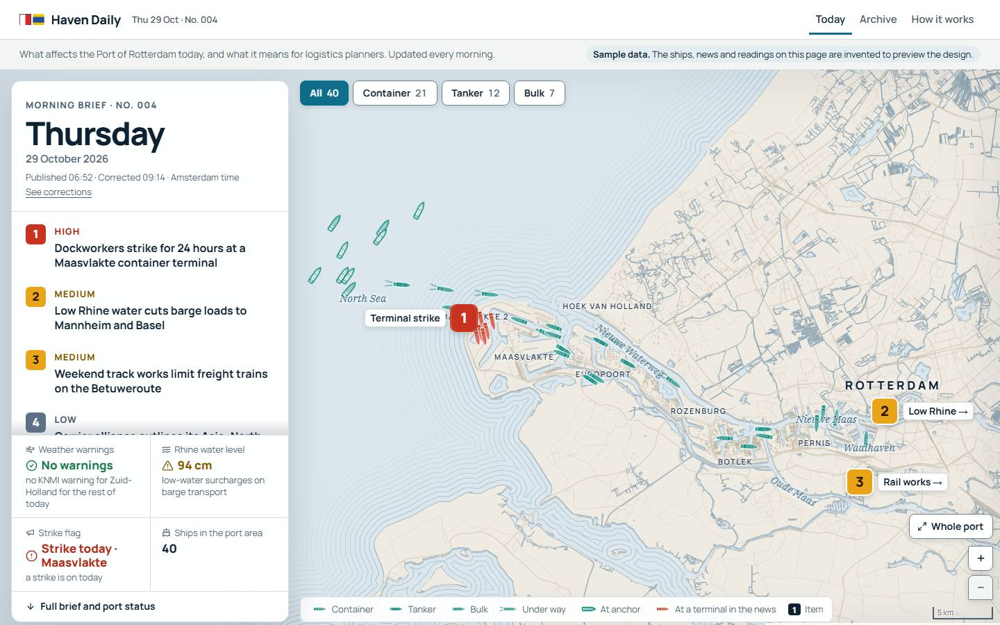 |
| Day page (27 Oct) | 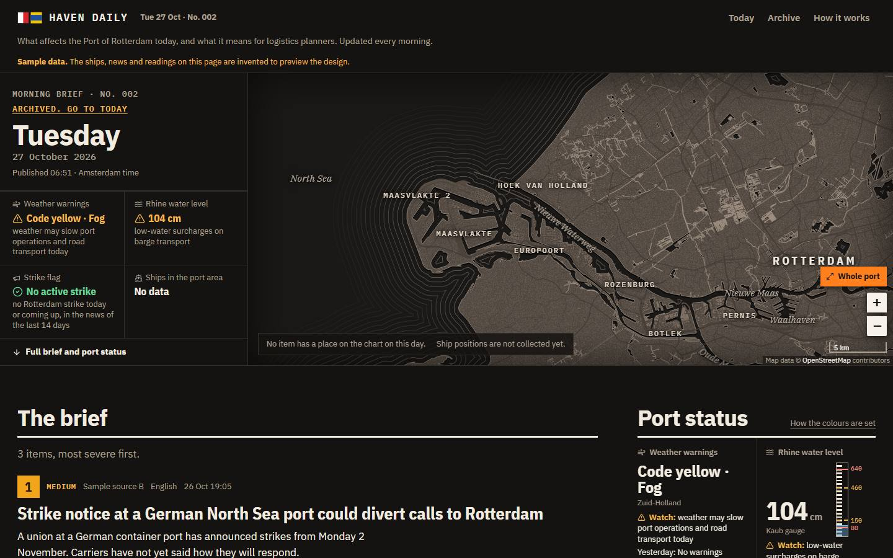 | 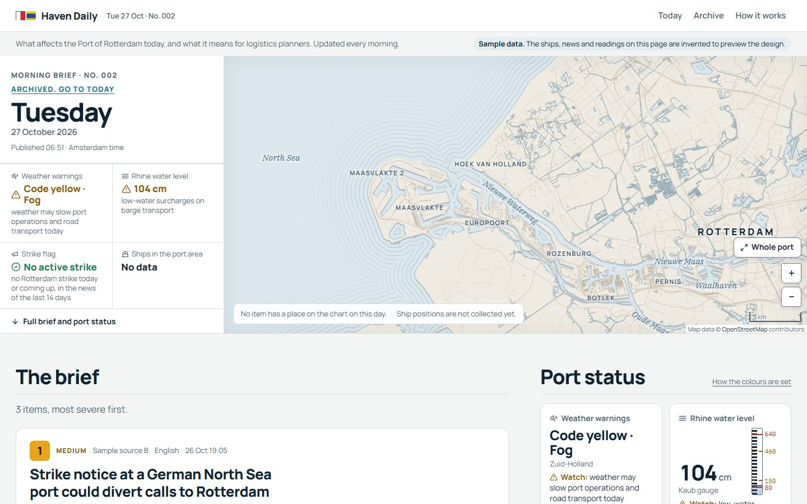 |
| Archive | 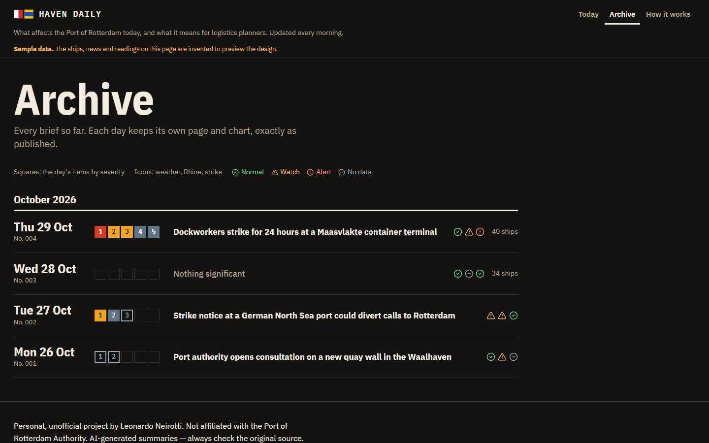 | 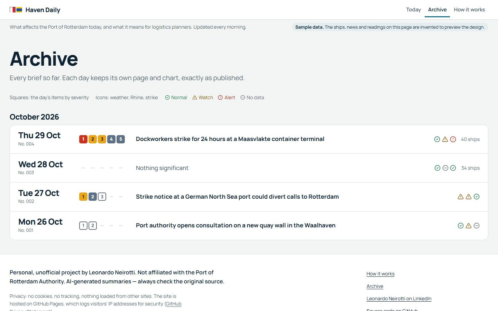 |
| How it works | 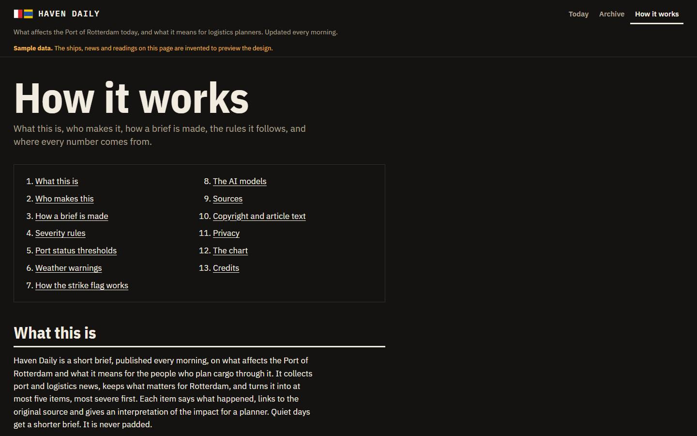 | 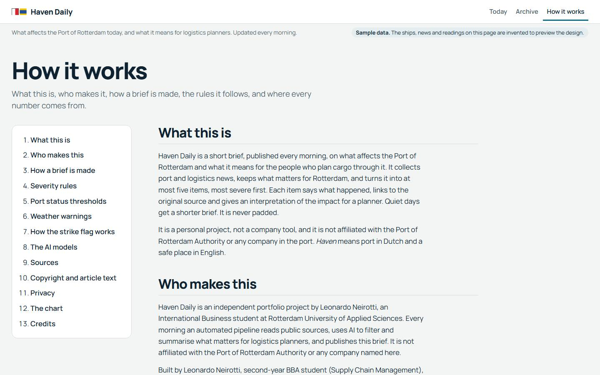 |

First screen, phone (390 × 844):

| | Today | Day page | Archive | How it works |
|---|---|---|---|---|
| Before |  | 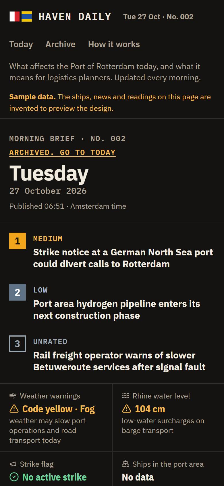 | 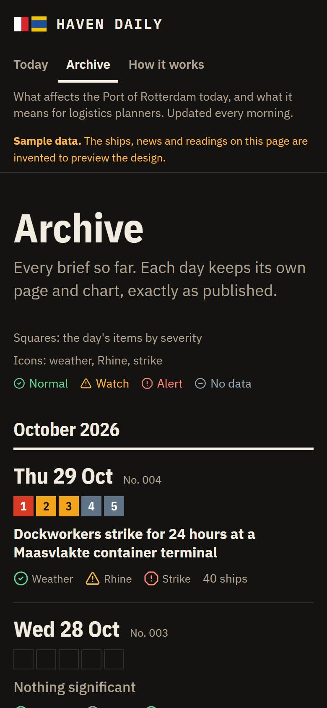 | 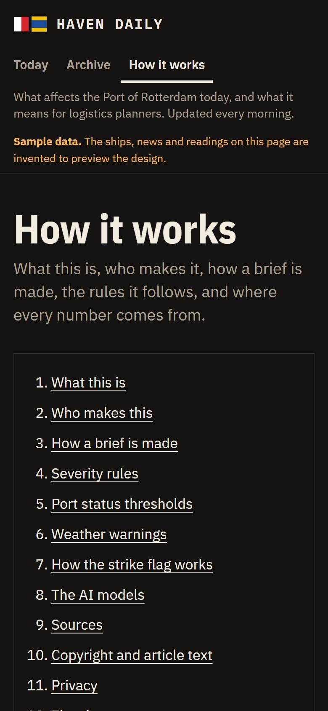 |
| After | 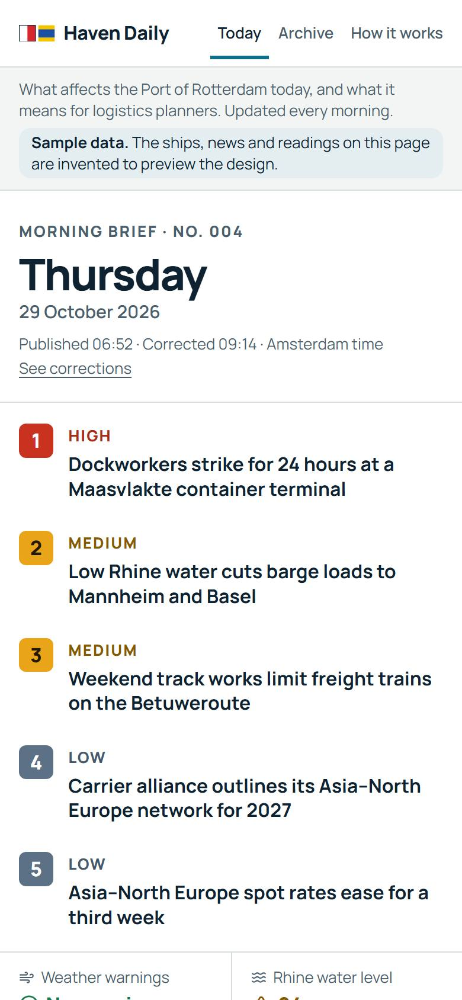 | 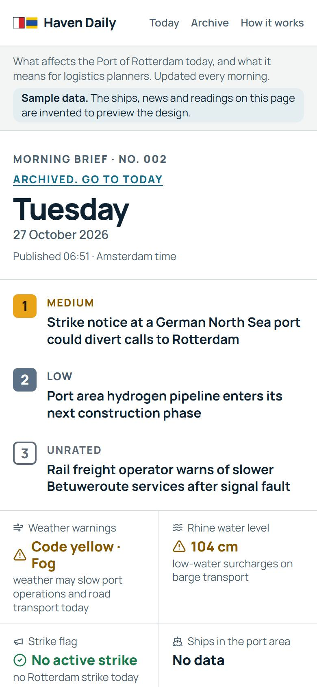 | 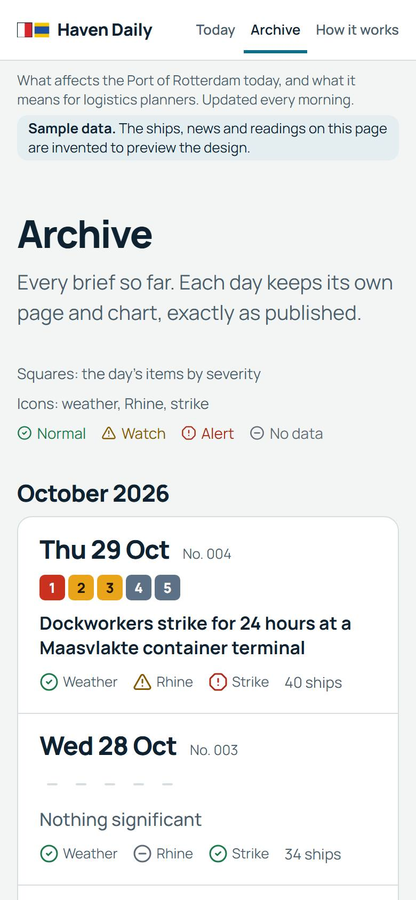 | 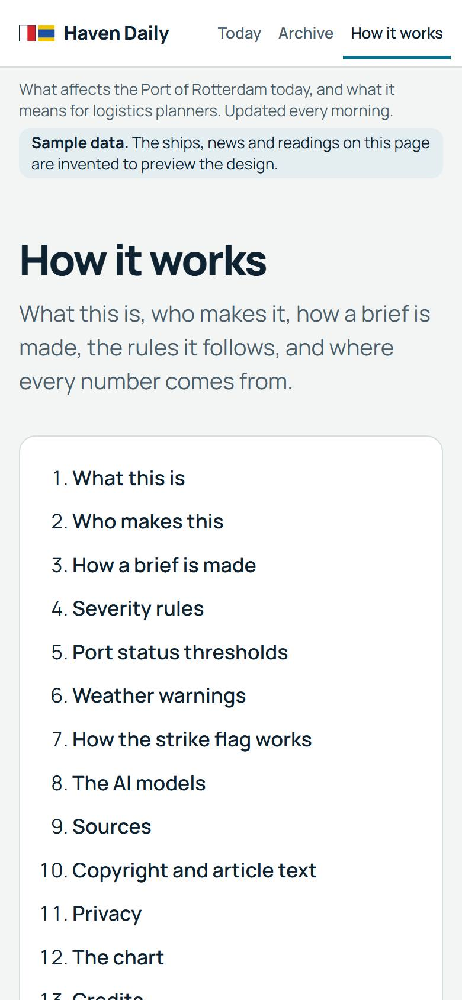 |

Whole pages, trimmed so this folder stays small (owner, 20 Nov 2026): the first 3000 px of each page, the laptop at half size.

| | Laptop | Phone |
|---|---|---|
| Today | [before](before/today-laptop-full.jpg) · [after](after/today-laptop-full.jpg) | [before](before/today-phone-full.jpg) · [after](after/today-phone-full.jpg) |
| Day page | [before](before/day-laptop-full.jpg) · [after](after/day-laptop-full.jpg) | [before](before/day-phone-full.jpg) · [after](after/day-phone-full.jpg) |
| Archive | [before](before/archive-laptop-full.jpg) · [after](after/archive-laptop-full.jpg) | [before](before/archive-phone-full.jpg) · [after](after/archive-phone-full.jpg) |
| How it works | [before](before/how-it-works-laptop-full.jpg) · [after](after/how-it-works-laptop-full.jpg) | [before](before/how-it-works-phone-full.jpg) · [after](after/how-it-works-phone-full.jpg) |

The mockup the owner picked (PR #103): [laptop](mockup/harbour-today-laptop-first.jpg), [phone](mockup/harbour-today-phone-first.jpg). Directions B (Front Page, bold editorial) and C (Bridge Console, technical dashboard) stay in the closed draft PR #103; their files are not kept here.

## The critique, and what fixed each point

The critique of the site before this pass (PR #103), point by point. Tests: `tests/test_style_pass.py`.

**What worked and stays:** the chart on the first screen, the severity squares (red / amber / slate, numbered, the same in the list and on the chart), the structure from the design review (#81–#86).

| # | Before | After |
|---|---|---|
| **Dated** | | |
| 1 | The header read like a developer tool: brand in spaced monospace capitals, small flags, two more small lines. | A white bar with the flags and **"Haven Daily" in Manrope 800**, the navigation on the right; the one-liner and the sample note on one line right under it (laptop). |
| 2 | Spaced monospace capitals did six jobs (brand, kickers, severity words, the date, land names, table headers). | **Mono is for data only**: times, readings, the KNMI line, AIS text, gauge marks. Labels are Manrope capitals; the brand and the date are plain words. |
| **Plain** | | |
| 3 | Below the first screen, one flat column separated by 1 px rules. | **White cards with soft corners** for items and dials; the impact on a faint plum wash; About and "How this brief was made" set off by a rule. |
| 4 | Archive and How it works used half a laptop's width, under an 88 px title. | Title at most 56 px. **Archive**: each month one card of day rows, the full page width. **How it works**: the contents list stands beside the text and stays in view while reading (≥ 72rem). |
| 5 | The footer was a block of small grey text. | **White footer in two columns** (laptop): the disclaimer and privacy note left, links and credits right. |
| **Crowded** | | |
| 6 | Port status: 12–13 px text, an 11 px disclaimer, 10 px gauge labels in a 24rem column. | Column **28rem**; dials as cards with a gap; small text **13 px** at least, the disclaimer 12 px, gauge labels 11 px. |
| 7 | The laptop panel cut item 4 mid-line with no hint that the list scrolls. | **A soft shade at the edge that has more**; it disappears at the end of the list (CSS only). |
| 8 | "Terminal strike" sat over "MAASVLAKTE 2"; labels collided. | **Item labels on small white cards**; land names smaller and lighter, with a white halo. |
| 9 | On a phone the header took about a quarter of the first screen. | **One bar** (brand and nav on one row); the one-liner and sample note scroll away; the bar itself slides away while reading ([below](#the-header)). |
| **Inconsistent** | | |
| 10 | Six hues competed; the **orange "Whole port" button** sat beside amber Medium squares and read like a severity. | **No orange anywhere.** "Whole port" is an ordinary button. Each colour has one meaning: red / amber / slate severity, green / amber / red status, teal ships, plum interpretation, and **harbour blue only for what is pressed or selected** (tested: the accent may fill or underline a control only in its pressed, current or active state). |
| 11 | **Five button styles**: outlined box, bold underlined links, filled orange, ivory zoom squares, a segmented filter. | **One button set** (`.btn`): same height (36 px, 44 px on touch screens), corners, edge and type, white with a navy label, harbour blue when pressed. "Show on chart", "Read original", "Read in English", the ship filter, Overview, Whole port, the zoom buttons and the popup's news button all use it. A button inside running text ("12 at anchor", a ship's name) looks like a link. |
| 12 | Archive: an empty slot and an unrated item were both outlined squares. | **An empty slot is a short dash**; unrated keeps its outlined square. |
| 13 | The land's random grain looked noisy, like a photo. | **Flat sand land** with a fine coastline, like a drawn chart (and a little less work on every repaint). |

## Harbour Light: colours and fonts

Every text colour passes WCAG AA (4.5 : 1) on the backgrounds it is used on, and the edge of a control 3 : 1 on every background it sits on (tested).

| Role | Colour | | Role | Colour |
|---|---|---|---|---|
| Page | `#f3f5f4` | | Sea / lines in the water | `#dbe7ed` / `#6f97ad` |
| Cards, panel, header | `#ffffff` | | Land / coast | `#efebe3` / `#8fa6b3` |
| Ink / secondary | `#0f2231` / `#4b5e6d` | | Ships | `#0f8a7c` |
| Rules / control edge | `#d6dee2` / `#728390` | | Accent: pressed or selected | `#0f6e8c` |
| High (fill / text) | `#c8321e` / `#ad2a17` | | Medium (fill / text) | `#eaa419` / `#875800` |
| Low (fill / text) | `#5d7186` / `#475a6d` | | Impact label / its wash | `#8a3a6c` / `#f8f2f6` |

**Fonts**, self-hosted, Latin and Latin Extended (hard rule 14):
- **Manrope** (one variable file, 400–800): text, headlines, labels, the brand. New; Fontsource 5.3.0, SIL OFL (`static/fonts/OFL-Manrope.txt`).
- **IBM Plex Mono 400**: data only.
- **IBM Plex Serif 400 and italic**: the planner impact (the only serif text) and water names on the chart.

Four Latin files, 80 KB (was eleven, 230 KB), well within the font budget (240 KB, 11 files, #104).

## The header

Visible when the page loads. While you scroll down it slides away; it comes back when you scroll up, when the cursor moves to the top 48 px of the window, or when it gets keyboard focus (also before the script reacts, through `:focus-within`). Nothing is stored. Without JavaScript it is an ordinary header that scrolls away. Things the page scrolls to (the chart, an item, a section of How it works) stop below it.

Checked in headless Edge on Today and How it works, phone (390 × 844, touch) and laptop (1440 × 900): shown on load; hidden after scrolling down; shown after scrolling up; hidden again; on the laptop shown with the cursor at the top; and shown with Shift+Tab from the content into the navigation, mid-page. 28 of 28 checks passed.

## Speed

See `docs/site-speed.md`, part 3: measured on a GitHub Actions runner, throttled phone, main against this branch in the same run.

## For the newspaper view (#101)

The style carries over: the tokens are the page's, the cards and the button set are reusable, and the newspaper's masthead and lead can use **IBM Plex Serif**, which is already on the site for the impact, so the newspaper view needs no new font. (The mockup's note that Harbour Light "would need a serif for the masthead" is answered by this.)

## How the pictures were made

```
python tools/style_pass_shots.py before --ref origin/main   # the site before this pass
python tools/style_pass_shots.py after                      # this branch
```

The tool builds the sample site (from the checkout, or from a git ref in a temporary worktree) and takes the pictures in headless Edge (spec §8.7), with reduced motion on. Each page is held in a frame of the exact screen size, because Edge won't make a window narrower than ~500 px, and the phone shots are cropped. For the whole-page shots the chart keeps its first-screen height. Nothing is fetched from the network.
