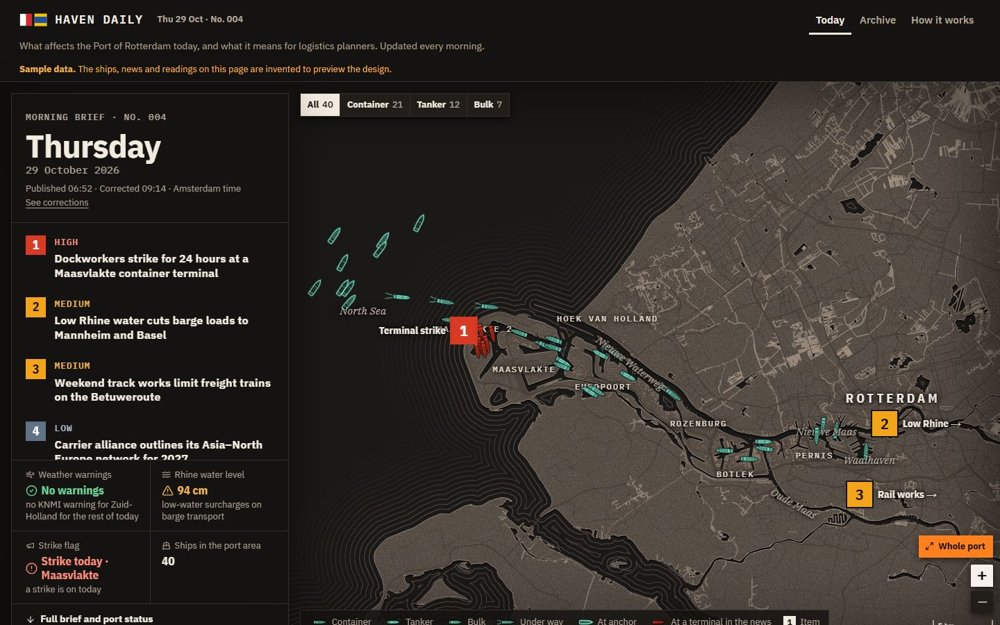
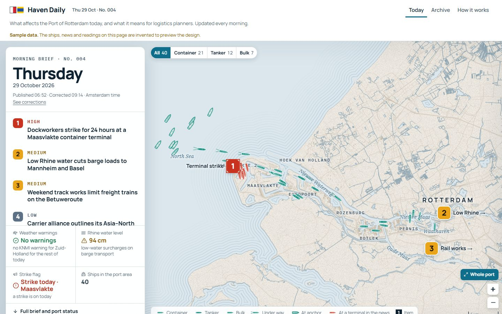
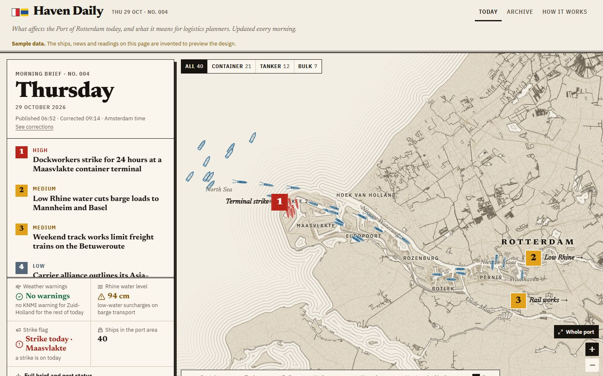
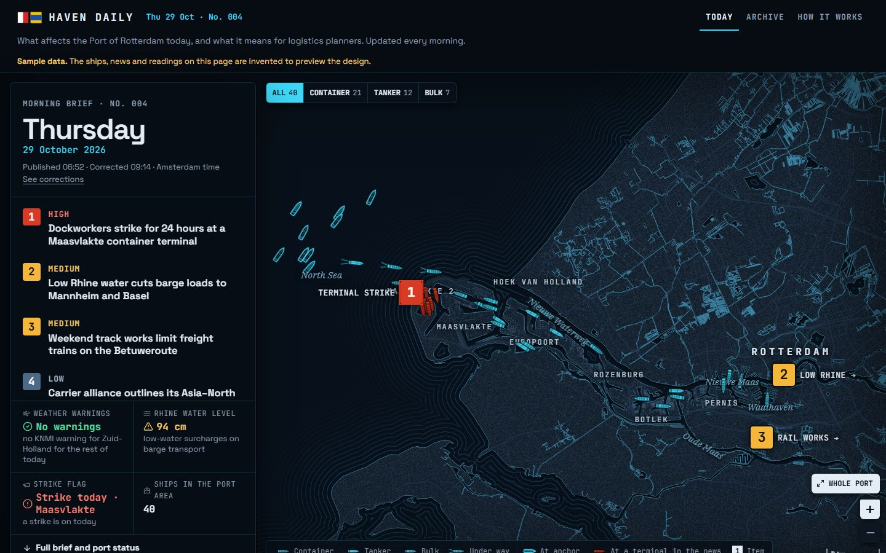
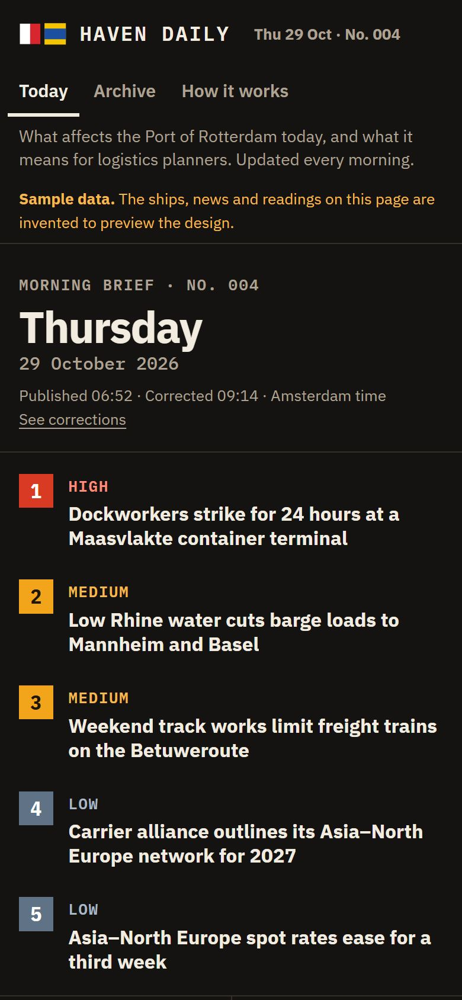
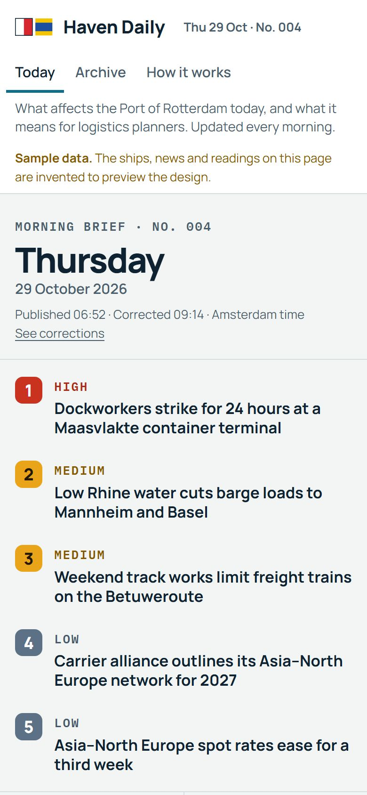
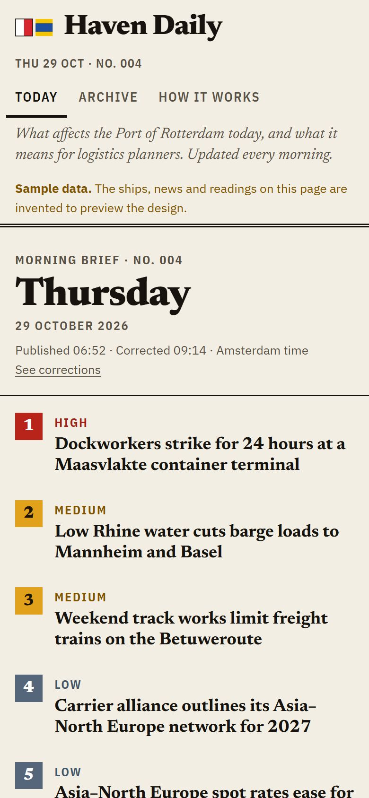
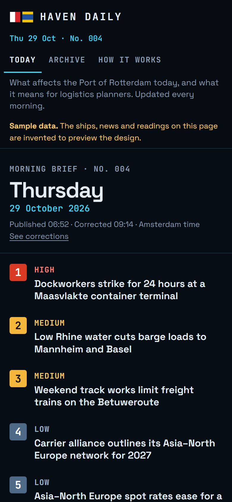

# Visual style pass (#102)

**Goal:** make the site look more polished and memorable for recruiters by changing **only the style** (colours, fonts, spacing, cards, buttons, how the map is drawn), never the structure (pages, chart, panel, dials). Every picture here uses the **sample briefs only** (hard rules 10 and 13).

**Status: waiting for the owner to pick one direction.** `templates/` and `static/style.css` are unchanged.

- [Step 1: the site today, and a critique](#step-1-the-site-today)
- [Step 2: three directions](#step-2-three-directions)
- [Side by side](#side-by-side)
- [How the pictures were made](#how-the-pictures-were-made)

## Step 1: the site today

Screenshots in [`current/`](current/): Today, a day page (Tue 27 Oct), Archive and How it works, each on a laptop (1440 × 900) and a phone (390 × 844), as the first screen (`-first`) and as the whole page (`-full`).

| | Laptop | Phone |
|---|---|---|
| Today | [first](current/today-laptop-first.jpg) · [full](current/today-laptop-full.jpg) | [first](current/today-phone-first.jpg) · [full](current/today-phone-full.jpg) |
| Day page | [first](current/day-laptop-first.jpg) · [full](current/day-laptop-full.jpg) | [first](current/day-phone-first.jpg) · [full](current/day-phone-full.jpg) |
| Archive | [first](current/archive-laptop-first.jpg) · [full](current/archive-laptop-full.jpg) | [first](current/archive-phone-first.jpg) · [full](current/archive-phone-full.jpg) |
| How it works | [first](current/how-it-works-laptop-first.jpg) · [full](current/how-it-works-laptop-full.jpg) | [first](current/how-it-works-phone-first.jpg) · [full](current/how-it-works-phone-full.jpg) |

### Critique

**What works:** the chart on the first screen is distinctive: nobody else's port page looks like a relief map under a lamp. The severity squares (red / amber / slate, numbered, the same on the list and the chart) are clear, and the structure from the design review (#81–#86) holds up.

**Dated**
1. **The header reads like a developer tool, not a publication.** Brand in spaced monospace capitals next to two small flags, then two more small lines (one-liner, sample note). It is the least memorable part of the page, and the first thing a recruiter reads. (The logo is already an open item, §7.6.)
2. **Spaced monospace capitals everywhere:** brand, kickers, severity words, the date, land names on the chart. One "terminal" voice used for six jobs makes the whole site feel like an early-2020s dashboard.

**Plain**
3. **Below the first screen the page goes flat** ([today, laptop, full](current/today-laptop-full.jpg)): one long charcoal column where the brief, the port status, About, the ship list and "How this brief was made" all have the same weight, separated only by 1 px rules. The polish of the first screen stops at the fold.
4. **Archive and How it works use about half the laptop's width** (text column ~55 % on How it works, ~73 % on Archive), under a 96 px page title with small body text: it looks like a default template. How it works is one 8,600 px column with a plain boxed contents list.
5. **The footer** is a block of small grey text with no structure.

**Crowded**
6. **The port status column is the densest part of the site:** 12–13 px text, the MeteoAlarm disclaimer in 11 px, two dials side by side in a 24 rem column, 10 px gauge labels.
7. **The laptop panel cuts item 4 mid-line** ("Carrier alliance outlines its Asia–North / Europe network…") with no fade or other hint that the list scrolls.
8. **Labels collide on the chart:** the "Terminal strike" callout sits over "MAASVLAKTE 2"; "Nieuwe Maas" is under the ships. (The pin layout is #85's; this is about label styling: halo, size, weight.)
9. **On a phone the header takes about a quarter of the first screen** (brand, nav, one-liner, sample note) before the brief starts.

**Inconsistent**
10. **Six hues compete, and the orange accent breaks the rule "colour carries meaning only"** (§7.1): the orange "Whole port" button sits beside amber Medium squares and reads like a severity. Add the pink impact label, teal ships and green OK.
11. **No shared button system:** an outlined box ("Show on chart"), bold underlined links ("Read original"), a filled orange button, ivory zoom squares and a segmented filter, each with its own size and weight.
12. **Archive: empty item slots and unrated items look alike:** both are outlined squares, one faint and one strong.
13. **The land texture** (random grain over sepia) looks noisy at laptop size, like a photo rather than a drawing.

## Step 2: three directions

Each direction is a **stylesheet loaded after the site's own** on a copy of the sample Today page. So it can change only how things look, never what the page contains: same HTML, same texts, same chart, panel and dials. The fonts sit next to it in `fonts/` with their licence (SIL OFL 1.1) and are loaded from there, never from another site (hard rule 14). The map is restyled through the same colour tokens `map.js` already reads.

All three keep the severity colours red / amber / slate (adjusted for contrast on light pages), and the principle "fact vs interpretation in two typefaces" (§7.3). **Every text/background pair in the table below passes WCAG AA (4.5 : 1)**, checked with a small script: ink and secondary ink on the page and on cards, the four severity inks, OK and No data, the impact label, the number on each severity square, the buttons, and the chart labels on land and water.

### A. Harbour Light (calm maritime): [`harbour/`](harbour/)

Fog-white page, deep navy ink, white cards with soft corners, a pale-blue sea with fine contour lines, sand-coloured land, deep teal ships, one harbour-blue accent for buttons.

| Role | Colour | | Role | Colour |
|---|---|---|---|---|
| Page | `#f3f5f4` | | Sea / contour lines | `#dbe7ed` / `#6f97ad` |
| Cards, panel | `#ffffff` | | Land / coast | `#efebe3` / `#8fa6b3` |
| Ink / secondary | `#0f2231` / `#4b5e6d` | | Ships | `#0f8a7c` |
| Rules | `#d6dee2` | | Accent (buttons, selected) | `#0f6e8c` |
| High (fill / text) | `#c8321e` / `#ad2a17` | | Medium (fill / text) | `#eaa419` / `#875800` |
| Low (fill / text) | `#5d7186` / `#475a6d` | | Impact label | `#8a3a6c` |

**Fonts:** **Manrope** 400–800 (headlines, UI, body; new), IBM Plex Mono (data, labels), IBM Plex Serif (planner impact only).
**Feels like:** a calm, modern product; reads well in daylight and when printed.
**Trade-off:** loses the dark "relief map" identity the owner liked (§7.1); friendly but less memorable.
**For the newspaper view (#101):** works as a clean light front page, but it would need a serif for the masthead and lead, which this direction doesn't have.

### B. Front Page (bold editorial): [`frontpage/`](frontpage/)

A printed page: warm newsprint, black ink, double and hairline rules, big serif headlines, the chart drawn like an engraving (paper sea with fine ink contour lines). **No brand colour at all**: the only colours are severity and status, so red always means High (this fixes critique point 10).

| Role | Colour | | Role | Colour |
|---|---|---|---|---|
| Page (newsprint) | `#f3eee3` | | Sea / contour lines | `#f3eee3` / `#5f574b` |
| Cards, panel | `#faf6ee` | | Land / coast | `#e3dac8` / `#6a6052` |
| Ink / secondary | `#17140f` / `#5a5247` | | Ships | `#1f5f8b` (ink blue) |
| Rules | `#cdc3b0` | | Buttons | ink `#17140f` on paper |
| High (fill / text) | `#b8241a` / `#a01f16` | | Medium (fill / text) | `#e2a11b` / `#825300` |
| Low (fill / text) | `#55667a` / `#44566a` | | Impact label | `#8b1e4f` |

**Fonts:** **Newsreader** 400–800 + italic (masthead, headlines, readings, and the planner impact in *italic*; new), IBM Plex Sans (body, UI), IBM Plex Sans Condensed (labels in spaced capitals).
**Feels like:** a "Daily" that really is one: the most distinctive and memorable of the three.
**Trade-off:** fact vs interpretation becomes **upright vs italic serif** for the impact, not "the only serif text" (§7.3 would change). The engraved land can look busy where the basemap has many small buildings (top right).
**For the newspaper view (#101):** carries over directly: same paper, fonts and rules. The newspaper view would be this style with a different layout.

### C. Bridge Console (technical dashboard): [`console/`](console/)

A ship's bridge at night: deep navy-black, instrument tiles with thin borders, a faint grid, cyan contour lines and ships, readings in a monospaced face.

| Role | Colour | | Role | Colour |
|---|---|---|---|---|
| Page | `#070d14` | | Sea / contour lines | `#08111b` / `#2f7896` |
| Tiles, panel | `#0d1621` | | Land / coast | `#13202e` / `#3f88a8` |
| Ink / secondary | `#e4edf5` / `#8b9cae` | | Ships, selected | `#3dd6f5` (cyan) |
| Rules | `#1d2b3a` | | Buttons | `#e4edf5` on `#070d14` |
| High (fill / text) | `#d93a24` / `#ff7d70` | | Medium (fill / text) | `#f4b63b` / `#f7c766` |
| Low (fill / text) | `#4d6985` / `#a0b6cc` | | Impact label | `#c39af0` |

**Fonts:** **Space Grotesk** 400–700 (headlines, UI, body; new), **JetBrains Mono** 400–700 (data, labels, readings; new, replaces Plex Mono), IBM Plex Serif (planner impact only).
**Feels like:** an operations tool for a planner; the closest to today's dark site, sharper and more consistent.
**Trade-off:** cyan-on-navy is a common "dashboard" look, so it's less unique. Lots of monospace makes long text slower to read.
**For the newspaper view (#101):** a poor fit; the newspaper view would need a separate light style.

## Side by side

Today page, first screen. Laptop (1440 × 900):

| Today's site | A. Harbour Light |
|---|---|
|  |  |
| **B. Front Page** | **C. Bridge Console** |
|  |  |

Phone (390 × 844):

| Today's site | A. Harbour Light | B. Front Page | C. Bridge Console |
|---|---|---|---|
|  |  |  |  |

Whole Today page (cards, port status, About, footer): [today's site](current/today-laptop-full.jpg) · [A](harbour/today-laptop-full.jpg) · [B](frontpage/today-laptop-full.jpg) · [C](console/today-laptop-full.jpg) on a laptop; [today's site](current/today-phone-full.jpg) · [A](harbour/today-phone-full.jpg) · [B](frontpage/today-phone-full.jpg) · [C](console/today-phone-full.jpg) on a phone.

### What the mockups don't show yet

- **Only the Today page.** Day pages share its styles, but Archive and How it works have their own components (archive rows, contents list, rules tables); the chosen direction is applied to them when it's built.
- **Critique points the stylesheet can't fix alone** are left for the build: the clipped panel item (7) needs a fade, which is style, but was left out of the mockups; the empty-slot vs unrated look (12); the width of Archive and How it works (4).
- **Fonts: Latin only.** The site's Plex files include Latin Extended; the build would add it for the new fonts too (§7.3 point 2), and `tests/test_fonts.py` would cover them.

## How the pictures were made

`python tools/style_pass_shots.py current harbour frontpage console` (≈ 4 min for `current`, ≈ 1.5 min per direction). It builds the sample site into a temporary folder and takes the pictures in headless Edge (spec §8.7), with reduced motion on. Each page is held in a frame of the exact screen size, because Edge won't make a window narrower than ~500 px, and the phone shots are cropped. For the whole-page shots the chart keeps its first-screen height. Nothing is fetched from the network. The new font files were downloaded once from the Fontsource packages on npm (`@fontsource/manrope`, `newsreader`, `space-grotesk`, `jetbrains-mono`, version 5.3.0, Latin subset), each with its licence file.
